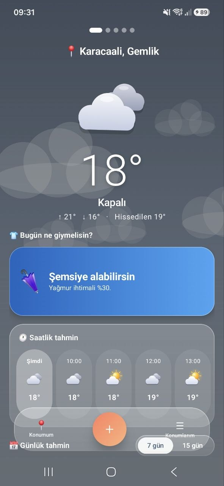
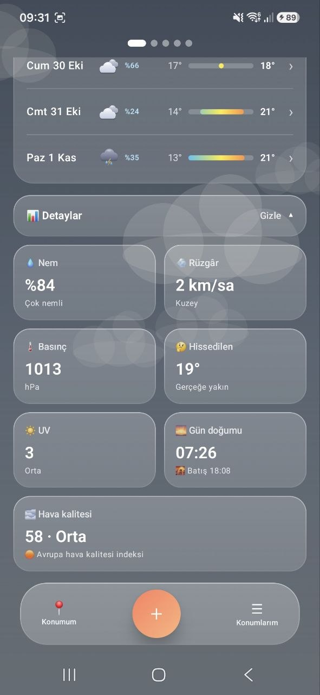
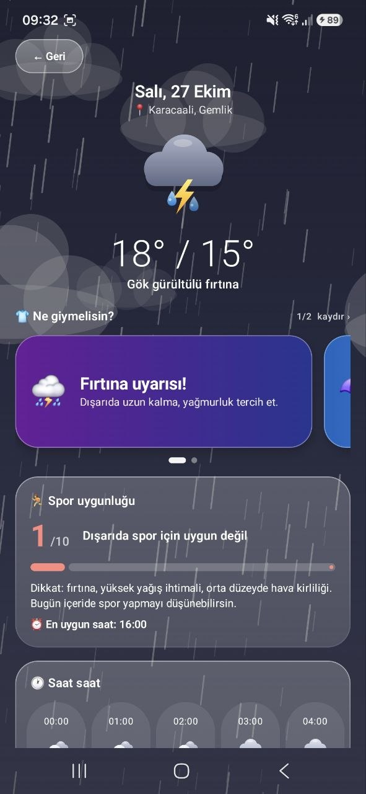
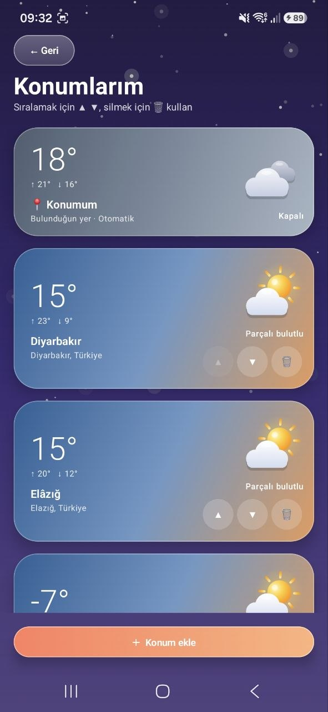
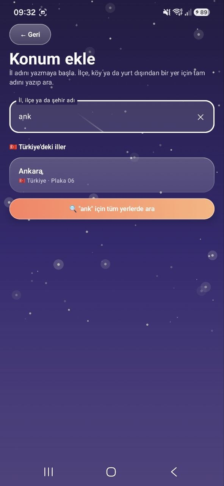

<div align="center">

# 🌤️ Hava Durumu

**Bulunduğun yerin havasını gösteren, ne giymen gerektiğini söyleyen, canlı ve renkli bir Android hava durumu uygulaması.**


*KAMP+ Bilişim Kampı (T.C. Gençlik ve Spor Bakanlığı · Turkcell Geleceği Yazanlar) Android eğitimi kapsamında geliştirildi.*

</div>

---

## 📸 Ekran Görüntüleri

<div align="center">

| Ana ekran | Detaylar | Gün detayı | Konumlarım | Konum ekle |
|:---:|:---:|:---:|:---:|:---:|
|  |  |  |  |  |

</div>

---

## ✨ Özellikler

### 📍 Konuma göre hava durumu
- Uygulama açılınca telefonun **bulunduğu yerin** havası otomatik gösterilir (ör. *Karacaali, Gemlik*).
- Konum izni verilmezse uygulama çökmeden durumu açıklar ve tekrar izin istemeyi sunar.

### 🌈 Havaya göre canlanan arayüz
- Arka plan rengi; **hava durumuna, mevsime, sıcaklığa ve gece/gündüze** göre değişir.
- Hareketli efektler: 🌧️ yağmur, ❄️ kar, ⚡ şimşek, ✨ yıldızlar, ☁️ süzülen bulutlar, 🌫️ sis, 🔥 sıcakta yükselen buhar, 🌸 ilkbaharda çiçek ve kelebekler, 🍂 sonbaharda düşen yapraklar.
- Emoji yerine **kodla çizilmiş 3B hava ikonları** (ışık yansımalı güneş, hilal ay, gölgeli bulutlar).

### 👕 Bugün ne giymelisin?
- Hava verisinden kurallarla üretilen öneriler: *Şemsiyeni unutma*, *Yanına hırka al*, *Güneş kremi sür*...
- Renkli kartlar halinde, **sağa kaydırarak** bir sonraki öneriye geçilir.

### 📅 Detaylı tahmin
- Saat saat 24 saatlik tahmin
- **7 / 15 günlük** tahmin, her gün için sıcaklık aralığı çubuğu
- Bir güne dokununca **gün detayı**: saatlik tahmin, yağış ihtimali ve miktarı, rüzgâr, nem, basınç, UV, gün doğumu/batımı, gün uzunluğu
- Açılıp kapanabilen **Detaylar** bölümü

### 🏃 Spor uygunluğu ve hava kalitesi
- Sıcaklık, yağış, rüzgâr, UV ve hava kalitesinden hesaplanan **10 üzerinden spor puanı**
- Günün **en uygun saati** önerisi
- Avrupa Hava Kalitesi İndeksi (AQI)

### 🗺️ Konumlarım
- Sınırsız konum ekleme, **sağa sola kaydırarak** konumlar arası geçiş (3B küp geçiş efekti)
- Her konum, kendi havasının renginde büyük bir kartta
- Sıralama (▲▼) ve silme; konumlar telefonda **kalıcı** olarak saklanır
- **Akıllı konum ekleme:** Türkiye'nin 81 ili internetsiz ve anında önerilir (`ard` → *Ardahan*); ilçe, köy ve yurt dışı yerler için tam adla arama
- Türkiye'deki yerler için **plaka**, diğer ülkeler için **bayrak** rozeti
- Arama sonuçları önce bulunduğun ülkeye, sonra **yakınlığa** göre sıralanır

---

## 🏗️ Mimari

Uygulama üç katmandan oluşur: **UI** görünümü çizer, **ViewModel** durumu yönetir, **Repository** veriye erişir.

```
UI (Composable)  →  ViewModel (StateFlow)  →  Repository (suspend)  →  Retrofit  →  Open-Meteo
                                            ↘  DataStore (kayıtlı konumlar)
                                            ↘  Fused Location + Geocoder (konum)
```

Her ekran dört durumu ele alır: **Yükleniyor · Başarılı · Boş · Hata**

```
com.kampplus.hava
├── MainActivity.kt
├── model/        Veri neye benzer?     City, Forecast, WeatherCondition, AirQuality,
│                                       KayitliKonum, GiyimUyarisi, SporUygunlugu, Rozet...
├── data/         Veri nereden gelir?   ApiClient, CityApi, ForecastApi, AirQualityApi,
│                                       WeatherRepository, KonumRepository, KonumlarimRepository...
└── ui/           Ne çizilir?
    ├── LoadState.kt · HavaNavHost.kt
    ├── home/       AnaEkran, Konumlarım, Konum ekle (+ ViewModel'ler)
    ├── forecast/   Tahmin ekranı, Gün detayı, ForecastViewModel
    └── theme/      3B ikonlar, hareketli efektler, cam bileşenler, tema
```

---

## 🛠️ Kullanılan Teknolojiler

| Alan | Teknoloji |
|---|---|
| Dil | Kotlin |
| Arayüz | Jetpack Compose, Material 3, Canvas ile özel çizim ve animasyonlar |
| Mimari | MVVM, ViewModel, StateFlow, State hoisting |
| Asenkron | Kotlin Coroutines (`async/await` ile paralel istekler, debounce) |
| Ağ | Retrofit + Gson |
| Navigasyon | Navigation Compose, HorizontalPager |
| Kalıcı veri | DataStore Preferences |
| Konum | Google Play Services Location, Android Geocoder |
| API | Open-Meteo (Geocoding, Forecast, Air Quality) |

---

## 🚀 Çalıştırma

1. Repoyu klonla:
   ```bash
   git clone https://github.com/Sumeyraadiyaman/hava-kampplus-app.git
   ```
2. Android Studio ile aç ve Gradle Sync'in bitmesini bekle.
3. ▶️ ile emülatörde ya da telefonda çalıştır.

> API anahtarı gerekmez. Emülatörde konumu test etmek için: **Extended Controls → Location** üzerinden bir konum seç.

---

## 🙏 Teşekkürler

- [KAMP+ Bilişim Kampı](https://github.com/tc-yusufburakdemir/weather-app) eğitmenlerine
- Hava verileri [Open-Meteo.com](https://open-meteo.com/) tarafından sağlanmaktadır ([CC BY 4.0](https://creativecommons.org/licenses/by/4.0/))

---

<div align="center">

**Sümeyra Adıyaman** · Yazılım Mühendisliği öğrencisi, Fırat Üniversitesi

[](https://github.com/Sumeyraadiyaman)
[](https://www.linkedin.com/in/sumeyra-adiyaman/)

</div>
